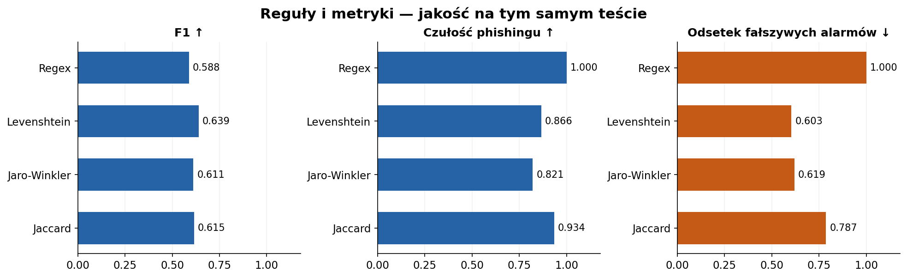
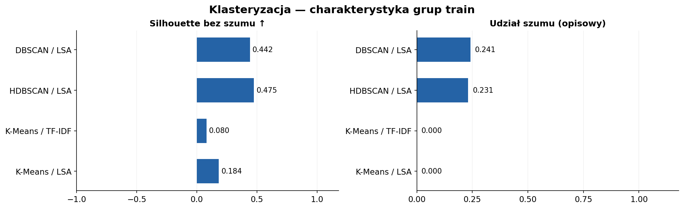
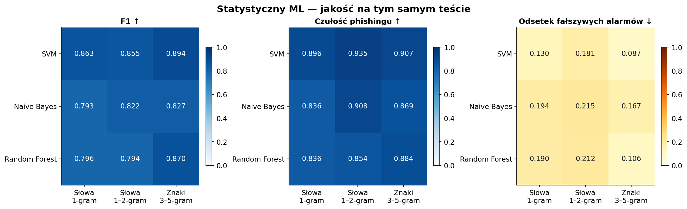
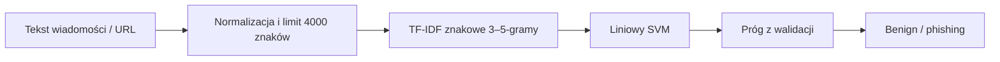

# phishing-detector

Lokalny filtr antyphishingowy oparty na **TF-IDF znakowych 3–5-gramów i liniowym SVM**.
Gotowy model, skrypty i notebook znajdują się w [`src/`](src/README.md).
Predykcja działa na CPU, bez internetu i API modeli.

**Wyniki na 15 351 próbkach testowych:**

| Kryterium | Wynik |
| --- | --- |
| Czułość | **92,14%** |
| FPR — fałszywe alarmy wśród legalnych próbek | **5,09%** |
| Rozmiar modelu | **0,329 MiB** |
| Predykcja | **0,921 ms/próbkę w batchu** |

Czas obejmuje normalizację, TF-IDF i SVM, bez ładowania plików; rozmiar dotyczy
skompresowanego modelu. Szczegóły: [raport testu](src/reports/test_metrics.json).

## Kluczowe wizualizacje z raportu

Poniższe wykresy porównują metody na próbie **8000 rekordów**. Tabela powyżej
opisuje końcowy model trenowany na pełnym zbiorze po deduplikacji.

**Reguły i podobieństwo tekstu:** regex, Levenshtein, Jaro–Winkler i Jaccard
wykazują wysoki odsetek fałszywych alarmów.



**Clustering:** DBSCAN, HDBSCAN i K-Means grupują podobne próbki.
Silhouette opisuje separację grup; klaster nie oznacza automatycznie phishingu.



**Statystyczny ML:** SVM z n-gramami znakowymi uzyskał najwyższe F1 w porównaniu
z Naive Bayes i Random Forest. Na tej podstawie wybrano architekturę rozwiązania.



Pełne omówienie, koszty predykcji i wyniki Isolation Forest: [raport](docs/raport.md).

## Architektura i działanie pipeline’u



Normalizacja scala białe znaki i zamienia litery na małe. TF-IDF koduje tekst
w maksymalnie 20 000 cech, a SVM oblicza margines decyzji — nie prawdopodobieństwo.
Model ładowany jest raz; `predict.py` obsługuje pojedynczy tekst oraz batche JSONL/CSV.

Trening używa wyłącznie części treningowej. Próg maksymalizuje czułość przy
FPR ≤5% na walidacji; nie gwarantuje tego limitu na nowych danych. Losowy test
mieszaniny URL, SMS, e-maili i HTML nie potwierdza odporności na Zero-Day.

## Uruchomienie

Python 3.12; komendy z katalogu głównego repozytorium:

```bash
python3 -m venv .venv
.venv/bin/python -m pip install -r src/requirements.txt
.venv/bin/python src/predict.py --text "Meeting tomorrow at ten."
.venv/bin/python src/evaluate.py --input src/examples/test.jsonl
```

[Instrukcja pakietu i treningu](src/README.md) · [Notatniki porównawcze](notebooks/)
· [Dane](data/README.md) · [Treść zadania](docs/zadanie/zadanie.md)
