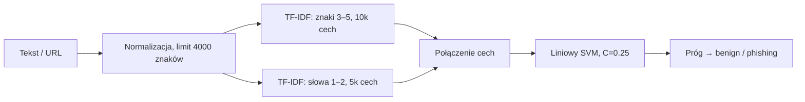

# Filtr antyphishingowy

Lokalny model **TF-IDF (znaki + słowa) i liniowy SVM**. Predykcja działa na CPU, bez API modeli i dostępu do sieci.

## Jak uruchomić

Python 3.12, komendy z katalogu repozytorium:

```bash
python3 -m venv .venv
.venv/bin/python -m pip install -r phishing-detector/src/requirements.txt
.venv/bin/python phishing-detector/src/predict.py --input phishing-detector/src/examples/test.jsonl --output /tmp/predictions.jsonl
.venv/bin/python phishing-detector/src/evaluate.py --input phishing-detector/src/examples/test.jsonl
.venv/bin/python phishing-detector/src/train.py --input /sciezka/trening.json --output-dir /tmp/moj-model
```

W predykcji i ocenie zastąp ścieżkę do `examples/test.jsonl` własnym plikiem w `--input`.
Obsługiwane dane: **CSV, JSON, JSONL**, również `.gz`. Pole `text` zawiera tekst lub URL; do treningu i oceny potrzebne jest `label`: `0` = benign, `1` = phishing. `id` jest opcjonalne. JSON to lista obiektów, JSONL — jeden obiekt na wiersz.
Nazwy pól i etykiety można zmienić przez `--text-column`, `--label-column`, `--positive-label`, `--negative-label`; separator CSV przez `--delimiter`.
Własny model wskazuje się przez `--model /tmp/moj-model/models/pipeline.joblib`. Przykłady i komendy notebooka: [instrukcja pakietu](phishing-detector/src/README.md).

## Architektura



Słowniki i SVM są uczone tylko na treningu. Próg minimalizuje FPR przy czułości ≥92,8% na walidacji. SVM zwraca margines, nie prawdopodobieństwo. Dane treningowe podaje użytkownik; nie są dołączone do repozytorium.

## Working tree

```text
phishing-detector/src/
├── predict.py, evaluate.py, train.py   # skrypty CLI
├── core.py, data.py, modeling.py       # pipeline i obsługa danych
├── optimize.py                        # porównanie modeli na walidacji
├── compression.py, compress_model.py  # selekcja cech, kwantyzacja, zapis
├── search_compression.py              # wybór kompresji na walidacji
├── models/                            # gotowy model i metadane
├── notebooks/training.ipynb           # wykonany notebook rozwiązania
├── examples/test.jsonl                # 200 próbek do sprawdzenia pakietu
├── reports/                           # wyniki, diagram i porównanie
└── tests/, requirements*.txt, run_notebook.py
```

## Wyniki po kompresji

Porównanie na tych samych **15 351 próbkach testowych**, po wyborze wariantu wyłącznie na walidacji:

| Miara | Przed | Po |
| --- | --- | --- |
| Rozmiar modelu | 0,681 MiB | **0,073 MiB** |
| Czułość | 92,49% | **92,63%** |
| FPR | 2,96% | **3,14%** |
| Precision | 95,71% | 95,47% |
| F1 | 0,9407 | 0,9403 |
| Fałszywe alarmy / przeoczony phishing | 265 / 480 | **281 / 471** |
| Predykcja [ms/próbkę] | 0,892 | **0,788** |
| Ładowanie [ms] | 127,3 | **13,5** |

Model zmniejszono o **89,29% (9,33×)** względem poprzednich 0,681 MiB; ma dokładnie **76 518 bajtów**. To rozmiar pliku modelu, nie całego repozytorium ani zależności Pythona.

Czułość wzrosła o 0,14 punktu procentowego, FPR wzrósł o 0,18 punktu procentowego. W całym teście oznacza to 9 mniej przeoczonych ataków i 16 dodatkowych fałszywych alarmów. Zmieniły się 193 klasyfikacje. Czas to mediana pięciu pomiarów po rozgrzewce na batchu 512 próbek; oba modele zmierzono ponownie na tym samym CPU. Pomiar predykcji nie obejmuje ładowania modelu/danych, a wyniki czasowe zależą od obciążenia.

## Jak uzyskano mniejszy model

1. Z bazowych 60 tys. cech znakowych i 30 tys. słownych zachowano **10 tys. znakowych i 5 tys. słownych** według bezwzględnych wag SVM wyuczonych na train.
2. Ponownie nauczono SVM na train po zmianie normalizacji TF-IDF. IDF i słowniki nie korzystają z walidacji ani testu.
3. 99,9% wag zaokrąglono do wspólnej siatki **6-bitowej**; 15 największych wag zachowano dokładnie. Podczas predykcji wagi nadal są float32, bez dodatkowego dekodera lub własnych klas modeli.
4. Słowniki zapisano jako uporządkowane sekwencje, bez redundantnych indeksów, i zastosowano LZMA (6). Plik działa z joblib oraz standardowym scikit-learn.

Porównano 20 wariantów. Limity walidacyjne ustalono przed wyborem: spadek czułości ≤0,5 p.p., wzrost FPR ≤0,3 p.p. Wybrano najmniejszy dopuszczalny wariant; następnie na walidacji ustawiono próg z zachowaniem pierwotnego minimum czułości **92,8%**. Finalna walidacja: czułość 92,80%, FPR 3,06%. Test wykonano po zamrożeniu konfiguracji.

To ten sam, wcześniej używany losowy test. Wyniki nie zastępują niezależnej walidacji czasowej lub na nowych kampaniach.

[Raport końcowy](phishing-detector/src/reports/test_metrics.json) · [Porównanie kompresji](phishing-detector/src/reports/compression_comparison.json) · [20 wariantów walidacyjnych](phishing-detector/src/reports/compression_candidates.json).

Historyczne etapy: model 1,525 MiB → 0,681 MiB (sam zapis float32), następnie obecne 0,073 MiB (selekcja cech i kwantyzacja). Raporty `optimization.*` i `size_optimization.json` opisują wcześniejsze wersje.

Pełny trening od początku odtworzył identyczne słowniki, IDF, wagi, próg i macierz pomyłek. [Potwierdzenie odtwarzalności](phishing-detector/src/reports/reproducibility.json).
