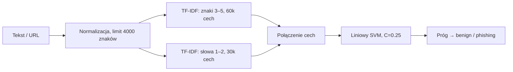

# Filtr antyphishingowy

Lokalny model **TF-IDF (znaki + słowa) i liniowy SVM**. Predykcja działa na CPU, bez API modeli i dostępu do sieci.

## Jak uruchomić

Python 3.12, komendy z katalogu repozytorium:

```bash
python3 -m venv .venv
.venv/bin/python -m pip install -r phishing-detector/src/requirements.txt
.venv/bin/python phishing-detector/src/predict.py --input phishing-detector/src/examples/test.jsonl --output /tmp/predictions.jsonl
.venv/bin/python phishing-detector/src/evaluate.py --input phishing-detector/src/examples/test.jsonl
.venv/bin/python phishing-detector/src/train.py --input /sciezka/trening.json --output-dir /tmp/moj-model
```

W predykcji i ocenie zastąp ścieżkę do `examples/test.jsonl` własnym plikiem w `--input`.
Obsługiwane dane: **CSV, JSON, JSONL**, również `.gz`. Pole `text` zawiera tekst lub URL; do treningu i oceny potrzebne jest `label`: `0` = benign, `1` = phishing. `id` jest opcjonalne. JSON to lista obiektów, JSONL — jeden obiekt na wiersz.
Nazwy pól i etykiety można zmienić przez `--text-column`, `--label-column`, `--positive-label`, `--negative-label`; separator CSV przez `--delimiter`.
Własny model wskazuje się przez `--model /tmp/moj-model/models/pipeline.joblib`. Przykłady i komendy notebooka: [instrukcja pakietu](phishing-detector/src/README.md).

## Architektura



Słowniki i SVM są uczone tylko na treningu. Próg minimalizuje FPR przy czułości ≥92,8% na walidacji. SVM zwraca margines, nie prawdopodobieństwo. Dane treningowe podaje użytkownik; nie są dołączone do repozytorium.

## Working tree

```text
phishing-detector/src/
├── predict.py, evaluate.py, train.py   # skrypty CLI
├── core.py, data.py, modeling.py       # pipeline i obsługa danych
├── optimize.py                        # porównanie modeli na walidacji
├── models/                            # gotowy model i metadane
├── notebooks/training.ipynb           # wykonany notebook rozwiązania
├── examples/test.jsonl                # 200 próbek do sprawdzenia pakietu
├── reports/                           # wyniki, diagram i porównanie
└── tests/, requirements*.txt, run_notebook.py
```

## Wyniki

Test: **15 351 próbek** (URL, SMS, e-maile, HTML).

| Miara | Wynik |
| --- | --- |
| Czułość | **92,49%** |
| FPR | **2,96%** |
| Precision / F1 | **95,71% / 0,941** |
| Rozmiar modelu | **0,681 MiB** |
| Predykcja | **1,060 ms/próbkę w batchu** |


FPR spadł z 5,09% do 2,96% (456 → 265 fałszywych alarmów). Czas obejmuje normalizację i predykcję, bez ładowania plików; rozmiar dotyczy skompresowanego modelu. To ten sam losowy test co wcześniej, nie niezależny benchmark nowych kampanii. [Pełne wyniki](phishing-detector/src/reports/test_metrics.json).

## Zmniejszenie rozmiaru

Model zmniejszono z **1,525 do 0,681 MiB** (**−55,35%**, **2,24× mniejszy**). Zachowano wszystkie 90 000 cech, IDF i próg. Zastosowano indeksy Python int, uporządkowany zapis słowników, wagi SVM float32 oraz kompresję LZMA (6), obsługiwaną bezpośrednio przez joblib. Nowy trening i wyszukiwanie również zapisują model w ten sposób, a próg nowych modeli dobierają po konwersji wag.

Porównanie na identycznych podziałach: **0 zmienionych klasyfikacji / 15 350 walidacyjnych i 15 351 testowych**. Czułość i FPR pozostały bez zmian. Float32 nie gwarantuje identycznych marginesów dla każdego możliwego wejścia. Obie wersje zmierzono ponownie na tym samym CPU; czasy zależą od obciążenia. [Dokładny raport rozmiaru, jakości, predykcji i ładowania](phishing-detector/src/reports/size_optimization.json). Wykres wcześniejszej poprawy FPR jest historyczny i pokazuje rozmiar sprzed kompresji.
