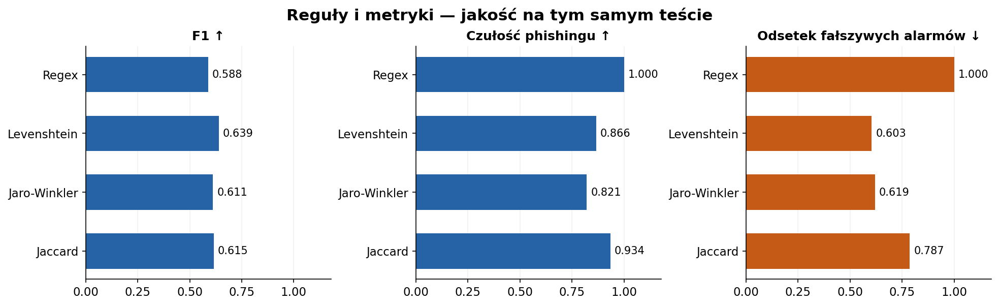
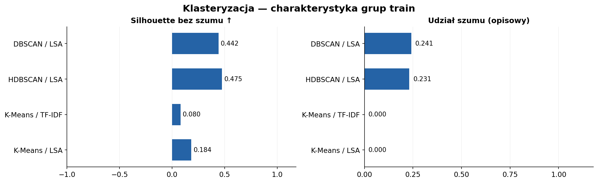
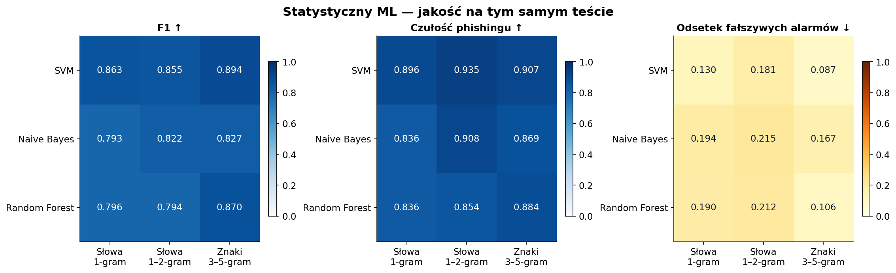
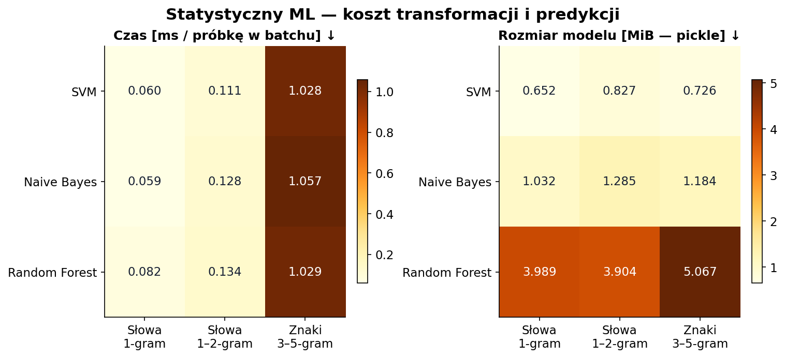

# Porównanie lokalnych metod detekcji phishingu

**Najważniejszy wynik:** SVM z TF-IDF znakowych 3–5-gramów uzyskał F1 **0,894**,
czułość **90,7%** i FPR **8,7%**. Model zajmuje około **0,73 MiB**, a transformacja
i predykcja trwają około **1,03 ms/próbkę w batchu**. To najlepszy wariant według
F1 walidacyjnego; nie jest to jeszcze filtr zweryfikowany produkcyjnie.

## Zakres i sposób oceny

Źródło: `ealvaradob/phishing-dataset`, wariant `combined_reduced`: 77 677 rekordów
obejmujących URL, SMS, e-maile i HTML. Eksperymenty wykonano lokalnie, bez API
modeli, na wspólnej próbie **8000 rekordów po deduplikacji**, z podziałem
4800/1600/1600 na trening/walidację/test i seed=42. Wejścia ograniczono do
4000 znaków. Reprezentacje uczono na treningu, a progi klasyfikacji dobierano
na walidacji. Podane wyniki klasyfikacji dotyczą testu.

**Czułość** oznacza udział wykrytego phishingu; **FPR** — udział legalnych próbek
błędnie oznaczonych jako phishing. **F1** łączy precision i czułość. Czasy są
medianą trzech pomiarów batchowych na współdzielonym CPU, a rozmiary oszacowano
przez pickle, bez środowiska wykonawczego. Nie są to gwarancje czasu pojedynczego
żądania. Wykresy poniżej pochodzą bezpośrednio z wykonanych notatników.

## 1. Reguły i metryki podobieństwa

| Metoda | Mechanizm i wynik |
| --- | --- |
| Regex | Szuka ustalonych sygnałów, np. presji czasu i żądania hasła. Próg wybrany pod F1 oznaczył **każdą próbkę jako phishing**: czułość i FPR wyniosły 100%. |
| Levenshtein | Mierzy podobieństwo przez koszt edycji znaków. Najwyższe F1 tej grupy: **0,639**, lecz FPR aż **60,3%**. |
| Jaro–Winkler | Porównuje znaki, premiując wspólny prefiks. F1 **0,611**, FPR **61,9%** — wspólny początek nie wystarcza do rozpoznania oszustwa. |
| Jaccard | Porównuje zbiory tokenów bez kolejności słów. Czułość **93,4%**, ale FPR **78,7%**. |

Metryki wykorzystują 64 wzorce z treningu, po 32 z każdej klasy. Wszystkie metody
są małe (poniżej 0,013 MiB) i szybkie (około 0,09–0,21 ms/próbkę), ale przy
uzyskanych progach generują zbyt wiele fałszywych alarmów. **Wysoki recall bez
kontroli FPR jest mylący**, co szczególnie pokazuje regex.

## 2. Clustering i wykrywanie anomalii

| Metoda | Najważniejsza obserwacja |
| --- | --- |
| DBSCAN + LSA | Wykrył **65 klastrów**, odrzucił **24,1%** treningu jako szum. Grupuje gęste rodziny bez zadawania liczby grup, ale zależy od promienia sąsiedztwa. |
| HDBSCAN + LSA | Wykrył **52 klastry**, szum **23,1%**, silhouette **0,475**. Obsługuje zmienną gęstość; w tej implementacji nowe batche wymagają ponownej klasteryzacji. |
| K-Means + TF-IDF | Podział na **12 grup**, silhouette **0,080**. Każda próbka otrzymuje grupę, dlatego udział szumu wynosi zero. |
| K-Means + embeddingi LSA | Lokalna kompresja TF-IDF do **64 wymiarów** podniosła silhouette do **0,184** przy 12 grupach. Nie używa pretrenowanego modelu językowego. |
| Isolation Forest + LSA | Wykrywa nietypowość, nie sam phishing. Na teście: czułość **15,9%**, FPR **5,1%**, F1 **0,259** — większość phishingu pozostała niewykryta. |

Silhouette opisuje separację klastrów treningowych, po wyłączeniu szumu;
różne zbiory odrzuconych punktów utrudniają bezpośredni ranking. Niskie ARI
(**0,008–0,036**) wskazuje, że grupy słabo odpowiadają podziałowi phishing/benign.
**Klaster nie jest klasą bezpieczeństwa, a anomalia nie musi być atakiem.**

W symulacji 40 wariantów nowej kampanii 38 dołączyło do klastra zawierającego
14 przykładów treningowych, a 2 uznano za szum. Nie powstała osobna nowa gęsta
grupa bez punktów treningowych. **Eksperyment nie potwierdził wykrywania nowości
kampanii ani odporności na Zero-Day.**

## 3. Statystyczny ML: TF-IDF i klasyczne klasyfikatory

Porównano dziewięć konfiguracji: **SVM, Naive Bayes i Random Forest** dla słownych
1-gramów, słownych 1–2-gramów oraz znakowych 3–5-gramów.

- **SVM:** najwyższe F1 w każdej z trzech reprezentacji. Wariant znakowy najlepiej
  łączy jakość i FPR; słowne 1–2-gramy podnoszą czułość do **93,5%**, lecz FPR
  rośnie do **18,1%**.
- **Naive Bayes:** prosty i szybki; F1 wynosi **0,793–0,827**. Wariant słowny
  1-gramowy potrzebuje około **0,059 ms/próbkę**, ale ustępuje jakością SVM.
- **Random Forest:** najlepszy z n-gramami znakowymi (F1 **0,870**), lecz jego
  model jest większy: około **5,07 MiB**, wobec **0,73 MiB** znakowego SVM.

N-gramy znakowe poprawiają wyniki wszystkich trzech klasyfikatorów względem
wariantu słownego 1-gramowego, ale zwiększają koszt transformacji tekstu.
**SVM ze słownymi 1-gramami** jest rozsądnym kompromisem do dalszej walidacji:
F1 **0,863**, czułość **89,6%**, około **0,060 ms/próbkę** i **0,65 MiB**.

## Wnioski

1. **Do dalszych prac nad filtrem:** znakowy SVM dla jakości albo słowny SVM
   dla mniejszego kosztu predykcji. Także najlepszy wariant ma FPR 8,7%, więc
   wymaga ograniczenia fałszywych alarmów przed automatycznym blokowaniem poczty.
2. **Do analizy kampanii:** clustering może wspierać grupowanie wiadomości
   i pracę analityka; Isolation Forest może sygnalizować nietypowe przypadki.
   Ich wyniki nie zastępują klasyfikacji phishingu.
3. **Granice oceny:** losowy podział mieszanego zbioru i jedna próba nie dowodzą
   skuteczności na przyszłych atakach. Potrzebne są niezależne testy czasowe,
   rozdzielenie kampanii/domen i dobór progów do kosztu błędów. Bliskie duplikaty
   mogą zawyżać wyniki mimo usunięcia identycznych wejść. Kaskady metod nie testowano.

### Materiały źródłowe

- [Notatnik 1: reguły i metryki](../notebooks/01_reguly_i_metryki.ipynb)
- [Notatnik 2: clustering i unsupervised](../notebooks/02_clustering_i_unsupervised.ipynb)
- [Notatnik 3: statystyczny ML](../notebooks/03_statystyczny_ml.ipynb)
- [Pełne tabele wyników i warunki pomiarów](../results/README.md)
