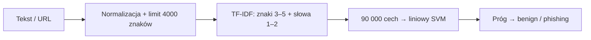
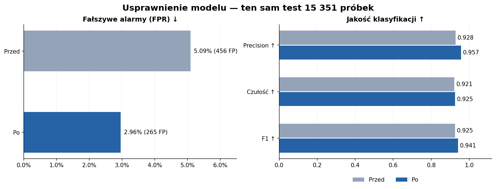

# Filtr antyphishingowy — pakiet rozwiązania

Gotowy model działa lokalnie. Nie wymaga treningu, internetu podczas predykcji ani danych spoza tego katalogu.

## Jak uruchomić

Python 3.12. Komendy z katalogu `phishing-detector/src/`:

```bash
python3 -m venv .venv
.venv/bin/python -m pip install -r requirements.txt
.venv/bin/python predict.py --text "Meeting tomorrow at ten."
.venv/bin/python predict.py --input /sciezka/dane.csv --output /tmp/predictions.jsonl
.venv/bin/python evaluate.py --input examples/test.jsonl
.venv/bin/python train.py --input /sciezka/trening.jsonl --output-dir /tmp/moj-model
```

CSV ma nagłówki `text,label` (`label` tylko do treningu/oceny); JSON to lista obiektów, JSONL — jeden obiekt na wiersz. Wszystkie formaty obsługują `.gz`, UTF-8 i opcjonalne `id`. Etykiety: `0` benign, `1` phishing. Wymagane są niepuste teksty; trening potrzebuje co najmniej 5 różnych wejść każdej klasy po deduplikacji.

Przykład własnych nazw pól i etykiet:

```bash
.venv/bin/python train.py --input /sciezka/dane.csv --text-column message --label-column category \
  --positive-label phishing --negative-label benign --delimiter ';' --output-dir /tmp/moj-model
.venv/bin/python predict.py --model /tmp/moj-model/models/pipeline.joblib --input /sciezka/nowe.jsonl
```

Wynik predykcji: JSONL z `id`, `label`, `prediction`, `score` i `threshold`. Bez `--output` trafia na stdout. `--batch-size` określa wielkość partii. `evaluate.py` przyjmuje te same opcje nazw kolumn i etykiet; `--model` wskazuje własny model. `score` to margines SVM, nie prawdopodobieństwo. Ładuj wyłącznie zaufane pliki joblib.

Notebook i testy:

```bash
.venv/bin/python -m pip install -r requirements-notebook.txt
.venv/bin/python run_notebook.py
.venv/bin/python -m unittest discover -s tests -v
```

Notebook domyślnie używa gotowego modelu i 200 dołączonych próbek. Do ponownego treningu ustaw w nim `DATASET`, opcjonalnie `DATA_OPTIONS`, i `RETRAIN=True`. Pełny dataset nie jest dołączony.

## Architektura



Trening usuwa identyczne wejścia i konflikty etykiet; dzieli wskazane dane 60/20/20 (seed=42). Reprezentacje uczone są wyłącznie na train; próg minimalizuje FPR przy walidacyjnej czułości ≥92,8%. `--min-recall` zmienia to minimum; alternatywne `--max-fpr` ustala limit walidacyjnego FPR. Test nie wybiera progu. Gotowy model ma SVM `C=0.25` i 60k cech znakowych + 30k słownych.

## Working tree

```text
models/                  # pipeline.joblib i metadata.json
notebooks/training.ipynb # notebook z wynikami i diagramami
examples/test.jsonl      # 200 rekordów z odłożonego testu
reports/                 # metryki i porównanie przed/po
predict.py, evaluate.py  # predykcja i ocena własnych plików
train.py, optimize.py    # trening i wybór modeli na walidacji
core.py, data.py, modeling.py, tests/, requirements*.txt, run_notebook.py
```

## Wyniki

Na **15 351 próbkach testowych**: czułość **92,49%**, FPR **2,96%**, precision **95,71%**, F1 **0,941**. Model: **0,681 MiB**; predykcja: **1,060 ms/próbkę w batchu** (mediana 5 powtórzeń, 512 próbek, CPU, bez ładowania modelu i danych).



[Raport testu](reports/test_metrics.json) · [Porównanie modeli](reports/optimization.md). Test był już używany wcześniej; wynik nie dowodzi odporności na nowe kampanie. Same URL nadal mają FPR około 10,2%. Dołączone 200 rekordów to podzbiór testu, nie nowa walidacja.

## Zmniejszenie rozmiaru

Model zmniejszono z **1,525 do 0,681 MiB** (**−55,35%**, **2,24× mniejszy**). Zachowano wszystkie 90 000 cech, IDF i próg. Zastosowano indeksy Python int, uporządkowany zapis słowników, wagi SVM float32 oraz kompresję LZMA (6), obsługiwaną bezpośrednio przez joblib. Nowy trening i wyszukiwanie również zapisują model w ten sposób, a próg nowych modeli dobierają po konwersji wag.

Porównanie na identycznych podziałach: **0 zmienionych klasyfikacji / 15 350 walidacyjnych i 15 351 testowych**. Czułość i FPR pozostały bez zmian. Float32 nie gwarantuje identycznych marginesów dla każdego możliwego wejścia. Obie wersje zmierzono ponownie na tym samym CPU; czasy zależą od obciążenia. [Dokładny raport rozmiaru, jakości, predykcji i ładowania](reports/size_optimization.json). Wykres wcześniejszej poprawy FPR jest historyczny i pokazuje rozmiar sprzed kompresji.
