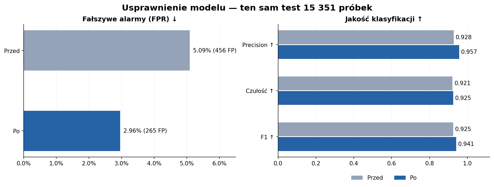

# Usprawnienie FPR i jakości

**Raport historyczny sprzed obu etapów kompresji.** Aktualny model ma 0,073 MiB; bieżące wyniki i koszt jakości: [compression_comparison.json](compression_comparison.json).

Zmieniono reprezentację i regularyzację, zamiast obniżać FPR wyłącznie kosztem czułości.
Wszystkie cechy i klasyfikatory dopasowano tylko na train. **Przed eksperymentem**
ustalono minimum czułości walidacyjnej 92,8% i kryterium wyboru: najniższy FPR,
potem wyższa czułość, a przy remisie mniejszy artefakt. Test nie wybierał konfiguracji.

## Porównanie na tym samym teście

| Miara | Przed: char20k, C=1 | Po: char60k + word30k, C=0,25 |
| --- | --- | --- |
| Czułość | 92,14% | 92,49% |
| FPR | 5,09% | 2,96% |
| Precision | 92,81% | 95,71% |
| F1 | 0,925 | 0,941 |
| Fałszywe alarmy | 456 | 265 |
| Przeoczony phishing | 502 | 480 |
| Model [MiB] | 0,329 | 1,525 |
| Czas batchowy [ms/próbkę] | 0,921 | 1,273 |

FPR zmalał względnie o **41,89%**, a czułość wzrosła
o **0,344 punktu procentowego**. Koszt to większy model
i dłuższa transformacja dwóch reprezentacji TF-IDF. Czasy są poglądowymi pomiarami
batchowymi na współdzielonym CPU; wynik przed zmianą pochodzi z poprzedniego wykonania.



## Kandydaci — wyłącznie walidacja

Walidacja: 15 350 rekordów, test: 15 351, train: 46 051. Podziały i normalizacja
pozostały identyczne. Char: znakowe 3–5-gramy; word: słowne 1–2-gramy.
Wszystkie modele mają class_weight=balanced. Większe C nie zawsze poprawia wynik.

| Kandydat | Czułość walidacji | FPR walidacji |
| --- | --- | --- |
| baseline-char20k | 92,82% | 5,02% |
| char60k-c0.25 | 92,80% | 3,72% |
| char60k-c1 | 92,86% | 3,26% |
| char60k-c4 | 92,82% | 4,07% |
| hybrid90k-c0.25 | 92,88% | 2,87% |
| hybrid90k-c1 | 92,80% | 2,90% |
| hybrid90k-c4 | 92,89% | 3,45% |
| hybrid90k-logistic-c4 | 92,80% | 3,00% |

**Wybrano hybrid90k-c0.25:** dwa wektory TF-IDF, FeatureUnion i LinearSVC C=0,25.
Model nie zawiera własnych klas serializowanych ani zdalnych zależności.
Logistic regression miała wyższe ROC-AUC, ale gorszy FPR przy wymaganej czułości.
Oryginalny baseline był ponownie progowany do tego samego minimum czułości
(stąd jego walidacyjny FPR 5,02% różni się od pierwotnego 4,98%).

## Kontrola błędów i niepewność

Na tych samych rekordach usunięto 234 wcześniejszych FP, ale wprowadzono
43 nowych. Odzyskano 141 przeoczonych wcześniej przypadków phishingu,
a 119 wcześniej wykrytych stało się FN. Bilans jest korzystny w obu klasach.

95% przedział Wilsona dla nowego FPR: **2,63%–3,33%**;
dla czułości: **91,82%–93,11%**.
Przedziały opisują liczebność tego testu; nie uwzględniają zależności między kampaniami ani driftu.

**Ograniczenie:** to ten sam, wcześniej używany losowy test, a nie nowy ślepy benchmark.
Zbiór miesza URL, SMS, HTML i e-maile. Wspólne domeny i bliskie duplikaty nadal mogą
zawyżać jakość; nie potwierdzono odporności na nowe kampanie ani Zero-Day.

### Diagnostyka typów wejścia

Grupy są rozpoznawane heurystycznie z tekstu, a nie etykietami źródła.
To diagnostyka po zamrożeniu modelu; nie służyła do wyboru konfiguracji.

| Grupa | Próbki | FPR przed → po | Czułość przed → po |
| --- | --- | --- |
| HTML-like (heuristic) | 2854 | 4,59% → 2,85% | 89,56% → 89,56% |
| Other text (heuristic) | 9817 | 3,78% → 2,00% | 91,56% → 92,28% |
| URL-only (heuristic) | 2680 | 15,75% → 10,22% | 94,64% → 94,42% |

Najtrudniejsze pozostają same URL: FPR nadal przekracza 10%, a czułość
w tej grupie minimalnie spadła. Poprawa wyniku łącznego nie oznacza poprawy
każdego wskaźnika w każdej grupie. Następny niezależny benchmark powinien
rozdzielać domeny/kampanie i czas.

## Odtworzenie

Z katalogu `phishing-detector/src/`:

```bash
.venv/bin/python optimize.py --input /sciezka/dane.json --output-dir experiments/optimization-new
.venv/bin/python train.py --input /sciezka/dane.json --output-dir experiments/retrained
.venv/bin/python evaluate.py --model experiments/retrained/models/pipeline.joblib --dataset /sciezka/dane.json
```

`optimize.py` porównuje osiem wariantów i zapisuje wybór bez oceny testu.
`train.py` odtwarza domyślną wybraną konfigurację oraz ocenia odłożony test.
Dodatkowy pełny retrening odtworzył współczynniki, próg i macierz pomyłek
dostarczonego modelu: [potwierdzenie odtwarzalności](reproducibility.json).
Dokładne wyniki: [walidacja](validation_candidates.json), [porównanie i diagnostyka](optimization.json),
[baseline](baseline.json), [test końcowy](test_metrics.json).
